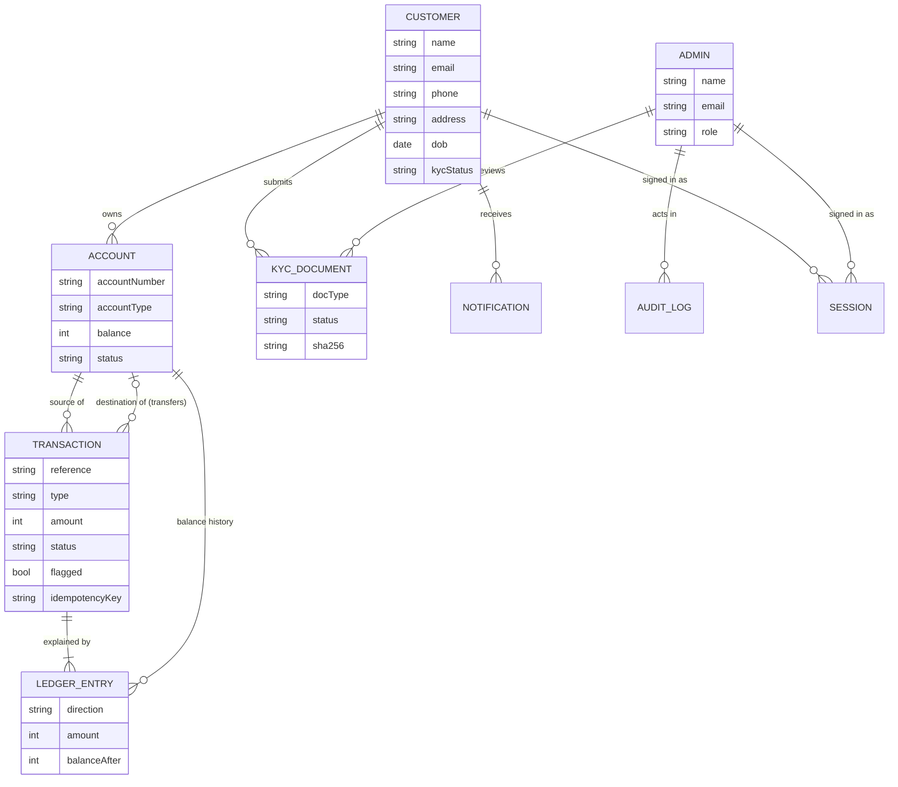
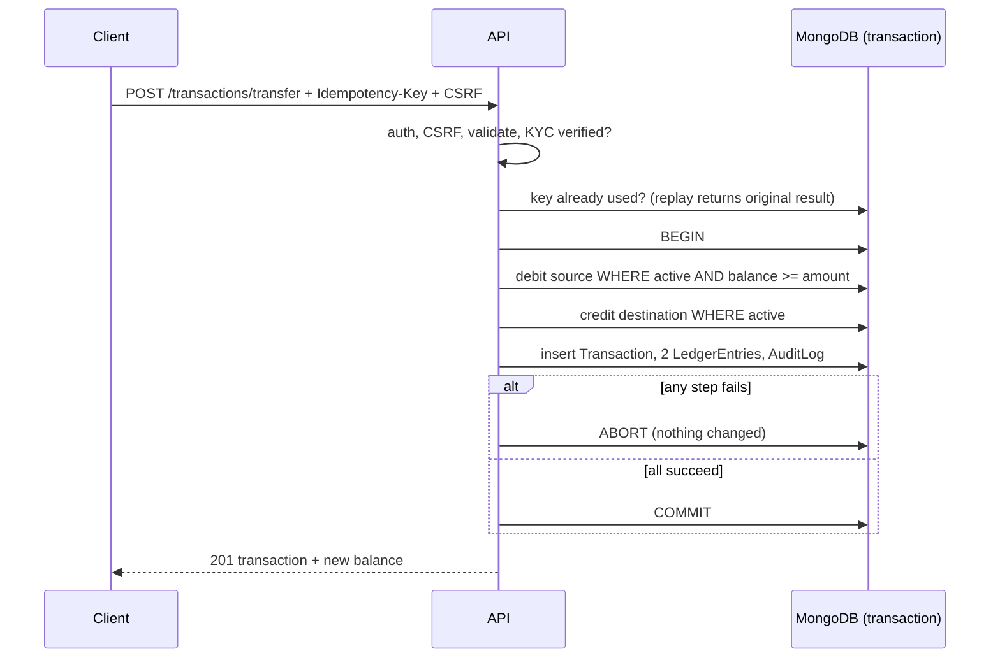

# Architecture

## Overview

```
 Browser (React + Vite)
   │  same-site /api calls, HTTP-only cookies, X-CSRF-Token header
   ▼
 Express API ── helmet · cors · origin guard · rate limit · sanitize · zod validation · auth/RBAC
   │   routes → controllers → services → models
   ▼
 MongoDB replica set (transactions)       Private upload folder (KYC files)
```

- **Routes and controllers** are thin: parse, call a service, shape the response.
- **Services** hold the rules. All balance changes live in one file, `services/ledger.service.js`.
- **Models** enforce data shape, immutability and append-only collections.
- **Realms:** customers and admins are separate (collections, cookies, token audiences, login endpoints), so one can never act as the other.

## Data model



The four core entities from the brief (Customer, Account, Transaction, Admin) hold the 25 required attributes. Supporting collections: `LedgerEntry`, `KycDocument`, `AuditLog`, `Notification`, `Session`.

| Collection | Notable rules |
|---|---|
| Customer | Unique lowercase email; 18+; `passwordHash` never selected or serialised; lockout counters hidden. |
| Account | Unique 10-digit number with Luhn check digit; balance is a non-negative integer (paise); owner, number and type immutable. |
| Transaction | Unique reference; amount, accounts, type and date immutable; unique `(customer, idempotencyKey)` partial index; transfers need a different destination. |
| LedgerEntry | **Append-only.** Unique `(transaction, account, direction)`. Stores `balanceAfter`. |
| AuditLog | **Append-only.** Actor, action, entity, IP, small non-sensitive `meta`. |
| Session | Only a keyed hash of the refresh token; TTL index removes expired rows; `replacedBy` links rotations. |
| KycDocument | `storagePath` is never returned by the API; SHA-256 of the file kept. |

## How a transfer works



Why it is safe:
- **Guarded updates.** The balance check is part of the update filter, so two simultaneous withdrawals cannot both pass a stale check.
- **Atomicity.** Both sides of a transfer, the ledger rows and the audit row commit together.
- **Idempotency.** A unique index on `(customer, key)` means two identical simultaneous requests cannot both commit; the loser returns the winner's result.
- **Conservation.** Debits and credits are written as pairs, so the sum of all balances equals the sum of all credits minus all debits. The tests assert this.
- **Failure records.** A rejected attempt (for example insufficient funds) becomes a `failed` transaction with no ledger rows and no key, so history is honest and retries are never blocked.

## Authentication and sessions

- Login returns two HTTP-only cookies plus a readable CSRF cookie. The access JWT lives 15 minutes; the cookie itself lives as long as the session so an expired token is reported (`TOKEN_EXPIRED`) rather than silently missing.
- Every request re-checks that the session is not revoked and the user is still active, so logout, password change and admin deactivation take effect immediately.
- Refresh tokens rotate. Using an already-used token (outside a 10 second grace window for two tabs) revokes all of that user's sessions and writes `TOKEN_REUSE_DETECTED`.
- CSRF token = HMAC of the session id with a server secret: stateless and unforgeable. Origin checks and SameSite cookies back it up.

## Authorisation (RBAC)

Roles map to permissions in `config/rbac.js`; an admin can also hold extra individual permissions. `requirePermission(...)` guards each admin route, the dashboard returns only the sections an admin may see, and the frontend hides pages an admin cannot use (the server is the real gate).

## KYC flow

Customer uploads a document → bytes are inspected (PDF, JPEG or PNG signature), hashed, stored privately under a random name → status `pending` → an officer reviews. Approving or rejecting, the customer's status, the notification and the audit entry commit in one transaction. Money movement requires `verified`.

## Frontend structure

`services/api.js` attaches the CSRF header and silently refreshes expired sessions (shared across parallel requests). `AuthContext` restores the session on load and redirects when it ends. List pages use `useAsync` (latest-request-wins) with debounced server-side search, filters and pagination.

## Design decisions worth knowing
- **Paise as integers** avoids floating-point errors.
- **Cached balance plus ledger.** Balance gives fast reads; the ledger is the audit-proof source, and tests verify they agree.
- **404, not 403, for other people's records** so existence is not revealed.
- **Fraud flags inform, they do not block.** False positives should not strand customers' money; humans review the queue.
- **Business rules in `config/policy.js`** so they are easy to find and change.
